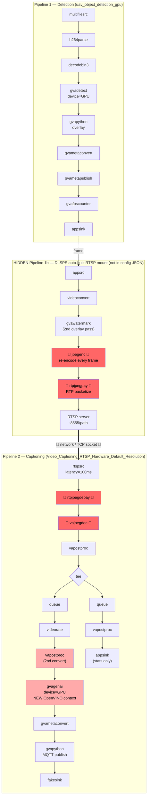
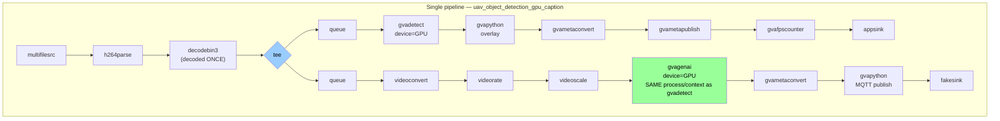

<!--
SPDX-FileCopyrightText: (C) 2026 Intel Corporation
SPDX-License-Identifier: Apache-2.0
-->

# Combined vs Separate Captioning Pipeline — Architecture Diagrams

Visual companion to [`BENCHMARK-COMBINED-VS-SEPARATE.md`](./BENCHMARK-COMBINED-VS-SEPARATE.md).
Shows the full GStreamer element graph for both architectures, including the
**hidden RTSP-mount pipeline** that DL Streamer Pipeline Server (DLSPS) builds
automatically for any pipeline whose destination is `type: rtsp` — it is not
present in `config-combined.json` and only appears in DLSPS runtime logs.

## Branches

| Branch | Architecture |
|---|---|
| `feature/uav-lvc-integration` | **Combined** — single GStreamer pipeline, `tee`'d after one decode, fans raw frames to both `gvadetect` and `gvagenai` in-process. |
| `feature/lvc-only-tr` | **Separate** — detection pipeline publishes RTSP (via DLSPS's auto-built mount); an independent captioning pipeline (launched by `video-caption-service`) connects back as an RTSP client. |

## Separate architecture — 3 pipelines stitched together by RTSP

🔴 = pure overhead that exists **only** because of the RTSP hop between two
independent pipeline instances; all of it disappears in the combined
architecture. 🟠 (lighter red) = duplicated work (2nd colorspace conversion,
2nd independent GPU/OpenVINO context) caused by the same split.

## Combined architecture — 1 pipeline, 1 process

No `jpegenc`, no `rtpjpegpay`, no RTSP hop, no `rtpjpegdepay`, no `vajpegdec`,
no second `vapostproc`, no second OpenVINO/GPU context. Raw `BGRA` frames fan
out via `tee` — zero-copy, in-process.

## What collapses away

| Stage present only in Separate | Removed in Combined because |
|---|---|
| `appsrc → videoconvert` (RTSP mount re-ingest) | No re-ingest — `tee` shares the one decoded frame in-process |
| 2nd `gvawatermark` overlay pass | Overlay only needs to happen once, on the single shared frame |
| `jpegenc` (full JPEG compression, every frame) | No serialization boundary to cross |
| `rtpjpegpay` → RTSP/TCP → `rtpjpegdepay` (+ 100 ms jitter buffer) | No network hop between detection and captioning |
| `vajpegdec` (full JPEG decode, every frame) | Frame is never re-encoded, so never needs re-decoding — also removes the `vajpegdec`/`jpegenc` codec-mismatch bug class entirely |
| 2nd `vapostproc` colorspace conversion | Conversion happens once (`videoconvert`/`videoscale`) before the `tee` |
| 2nd, independent OpenVINO/GPU context (`gvagenai` in its own pipeline) | `gvadetect` and `gvagenai` share one pipeline/context — avoids the `CL_OUT_OF_RESOURCES` → `CL_INVALID_EVENT` cascade seen when both pipelines contend for GPU memory independently |
| Two separately-managed pipeline lifecycles + shared-RTSP-destination `FLUSHING` stall bug class | Structurally impossible with only one pipeline instance |

**Net effect:** per-frame cost drops from *decode → detect → re-encode →
network → re-decode → convert → infer* down to *decode → tee → {detect,
infer}* — one decode, one conversion, one GPU context, zero network hops.
